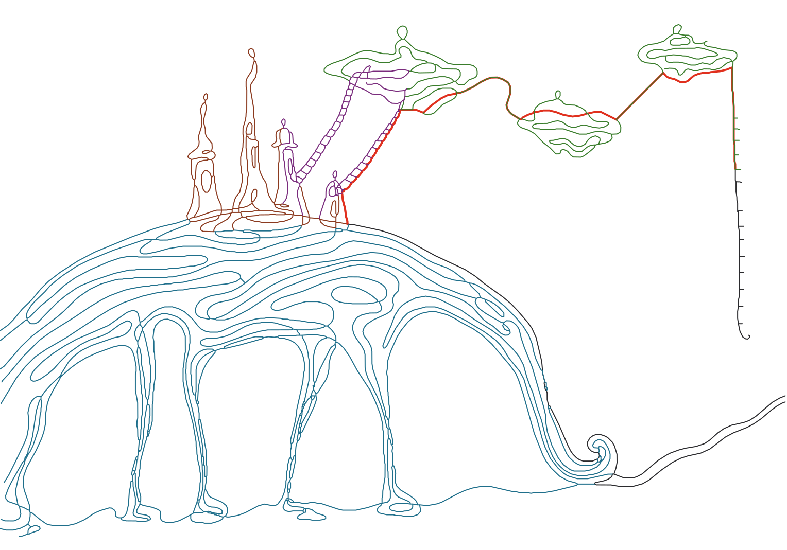
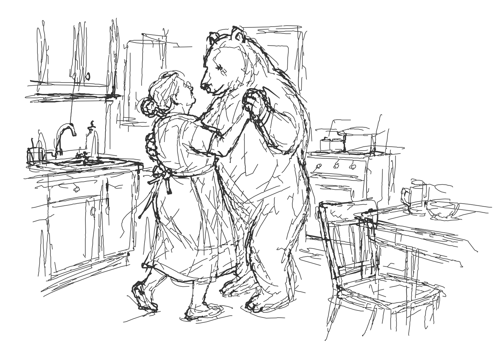

# Style history

How the drawings have looked over time. One picture per change of art style,
each tied to the commit that produced it.

Files are named `date_commit_style.png`. To see the code behind a picture:

```bash
git show <commit>
```

| Date | Commit | Style | Picture |
|---|---|---|---|
| 2026-11-25 | `71fc168` | Wire line: an abstract drawing as if bent from one piece of wire, with echo contours |  |
| 2026-11-26 | `4b4c316` | Pencil sketch: the image model draws a rough gesture sketch, and firm strokes are gone over several times |  |

## Adding an entry

When the style changes, commit the code first, then save a picture of the
result here named with that commit's short hash, add a row above, and commit
the picture.
